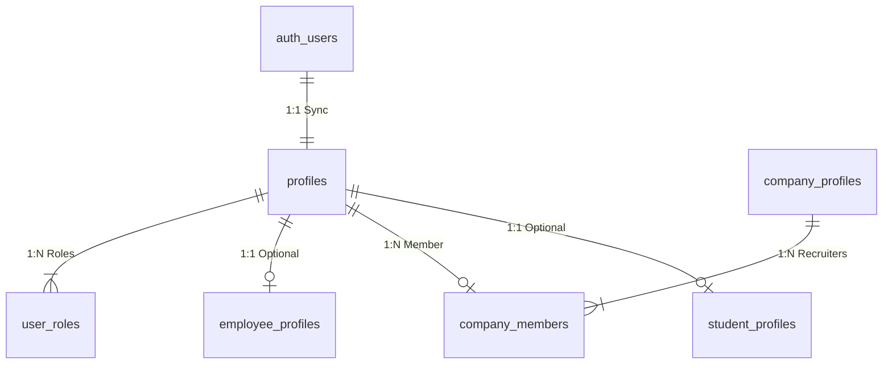
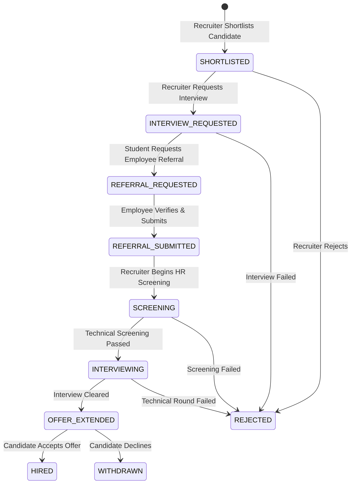

# Step 5A Database Design Report: Production Supabase PostgreSQL Schema & Security Architecture

> **DESIGN-ONLY TASK CONFIRMATION**
> This document represents a complete, production-grade **PostgreSQL & Supabase Architecture Design** for Hire Me Out.
> - **No Supabase tables were created or modified.**
> - **No remote SQL commands or migrations were executed (`supabase db push` was NOT run).**
> - **Prisma schema (`prisma/schema.prisma`) and SQLite database (`prisma/dev.db`) remain untouched.**
> - **No authentication, backend, or frontend code was altered.**
> - **No Git commit or push was performed.**

---

## 1. Executive Summary & Audit Verification

A rigorous review of the existing codebase (`prisma/schema.prisma`, `prisma/seed.ts`, `server/routes/`, `server/services/`, `src/types/index.ts`, `src/services/api.ts`, and `src/context/AuthContext.tsx`) was conducted to validate and refine the preliminary audit findings.

### Key Refinements from Audit:
1. **Role Governance**: The application supports four distinct account roles: `STUDENT`, `COMPANY`, `EMPLOYEE`, and `ADMIN`. In the current SQLite version, roles are passed directly in HTTP requests and JWT payloads without server-side database validation. The production design moves role authority strictly to `auth.users.app_metadata` and a dedicated `user_roles` database table guarded by PostgreSQL Security Definer functions.
2. **Normalizing JSON Text Blobs**: In `schema.prisma`, lists such as `targetRoles`, `missingSkills`, `techStack`, `optionsJson`, `answersJson`, `feedbackJson`, `strengthsJson`, `weaknessesJson`, `transcriptJson`, `requiredSkillsJson`, `preferredSkillsJson`, and `statusHistoryJson` were stored as plain stringified JSON. The production Supabase design normalizes relational sub-resources (`student_skills`, `student_projects`, `referral_status_history`) and utilizes native PostgreSQL `jsonb` or `text[]` array types where document flexibility is genuinely required.
3. **Multi-Recruiter Company Support**: The current code assumes a 1:1 link between a `User` and `CompanyProfile`. To support enterprise scalability, the production design decouples company entities into `company_profiles` and introduces `company_members` for multi-recruiter authorization.
4. **State Machine & Pipeline Integrity**: Current referral status transitions in `server/routes/referrals.ts` permit any role (including `STUDENT`) to update status. The new design enforces database-level RLS policies and PostgreSQL trigger validation so students cannot manipulate referral status or self-promote to `HIRED`.

---

## 2. Identity, Authentication & Role Governance Design

### 2.1 Identity Model (`auth.users` Integration)
Every registered account in Hire Me Out maps directly to one identity record in Supabase's `auth.users` schema (`auth.users.id` UUID).
- **Public Profile Sync**: A PostgreSQL `AFTER INSERT` trigger on `auth.users` automatically creates a corresponding row in `public.profiles`.
- **Single Active Profile Constraint**: A user identity is associated with exactly one active primary profile type (`STUDENT`, `COMPANY`, `EMPLOYEE`, or `ADMIN`), established during registration and backed by UNIQUE foreign key constraints (`profiles.id = student_profiles.user_id`, etc.).



### 2.2 Role Assignment & Escalation Prevention
- **Role Authority**: Roles are assigned at registration time via a controlled database function (`assign_user_role`) or trusted backend service.
- **Custom Claims**: Roles are injected into `auth.users.app_metadata` (`{"role": "STUDENT"}`) via a database trigger so Supabase Auth JWTs inherently contain the user's validated role.
- **Client Privilege Escalation Protection**: The `role` column in `public.user_roles` cannot be updated via the Supabase Data API by non-admin users. RLS explicitly denies `INSERT`/`UPDATE` operations on `user_roles` to standard users.

### 2.3 Role Helper Functions (Security Definer)
To eliminate redundant RLS logic and safeguard role evaluation, the database will expose standard Security Definer helper functions:

```sql
-- Helper function to fetch current authenticated user role
CREATE OR REPLACE FUNCTION public.get_user_role(user_id uuid)
RETURNS text
LANGUAGE sql STABLE SECURITY DEFINER
SET search_path = public
AS $$
  SELECT role FROM public.user_roles WHERE user_id = get_user_role.user_id LIMIT 1;
$$;

-- Helper function to check if user is Admin
CREATE OR REPLACE FUNCTION public.is_admin()
RETURNS boolean
LANGUAGE sql STABLE SECURITY DEFINER
SET search_path = public
AS $$
  SELECT EXISTS (
    SELECT 1 FROM public.user_roles 
    WHERE user_id = auth.uid() AND role = 'ADMIN'
  );
$$;

-- Helper function to check if user belongs to a specific company
CREATE OR REPLACE FUNCTION public.is_company_member(cid uuid)
RETURNS boolean
LANGUAGE sql STABLE SECURITY DEFINER
SET search_path = public
AS $$
  SELECT EXISTS (
    SELECT 1 FROM public.company_members 
    WHERE company_id = cid AND user_id = auth.uid()
  );
$$;
```

### 2.4 Account Lifecycle Management
- **Company Verification & Approval**: New company registrations create a `company_verifications` record with `status = 'PENDING'`. Unverified companies (`is_verified = false`) cannot publish jobs or request candidate interviews until approved by an `ADMIN`.
- **Account Suspension & Deletion**:
  - `profiles.status` column supports `'ACTIVE'`, `'SUSPENDED'`, `'DELETED'`.
  - Deleting an `auth.users` record triggers a `CASCADE` deletion across user profiles or sets nullable references to `NULL` (preserving anonymized platform metrics).
- **Ownership of User-Generated Data**: All candidate data (resume, assessments, projects) remain strictly owned by the candidate (`student_profiles.user_id = auth.uid()`). Candidates may set `privacy_level` to `'PRIVATE'` at any time to hide their profile from recruiter searches.

---

## 3. Complete Business Table Schema Design

Every model in `prisma/schema.prisma` plus newly required production entities are mapped below to complete PostgreSQL DDL definitions.

### 3.1 Table Index & Entity Summary

| PostgreSQL Table Name | Prisma Model Mapping | Purpose | Primary Key | Foreign Keys |
| :--- | :--- | :--- | :--- | :--- |
| `profiles` | `User` | Base user identity sync from `auth.users` | `id` (uuid) | `id REFERENCES auth.users(id)` |
| `user_roles` | *New* | RBAC role store (`STUDENT`, `COMPANY`, `EMPLOYEE`, `ADMIN`) | `id` (uuid) | `user_id REFERENCES profiles(id)` |
| `student_profiles` | `StudentProfile` | Candidate domain metrics & talent score | `id` (uuid) | `user_id REFERENCES profiles(id)` |
| `student_educations` | `Education` | Relational candidate education history | `id` (uuid) | `student_profile_id REFERENCES student_profiles(id)` |
| `student_experiences` | `Experience` | Relational candidate work experience | `id` (uuid) | `student_profile_id REFERENCES student_profiles(id)` |
| `student_skills` | `Skill` | Candidate verified skills | `id` (uuid) | `student_profile_id REFERENCES student_profiles(id)` |
| `student_projects` | `Project` | Candidate portfolio projects | `id` (uuid) | `student_profile_id REFERENCES student_profiles(id)` |
| `student_certifications` | `Certification` | Candidate certifications | `id` (uuid) | `student_profile_id REFERENCES student_profiles(id)` |
| `student_achievements` | `Achievement` | Candidate honors & awards | `id` (uuid) | `student_profile_id REFERENCES student_profiles(id)` |
| `company_profiles` | `CompanyProfile` | Verified employer profile | `id` (uuid) | `created_by REFERENCES profiles(id)` |
| `company_members` | *New* | Multi-recruiter company membership junction | `id` (uuid) | `company_id`, `user_id REFERENCES profiles(id)` |
| `company_verifications` | *New* | Employer legal/domain verification records | `id` (uuid) | `company_id REFERENCES company_profiles(id)` |
| `employee_profiles` | `EmployeeProfile` | Internal employee referrer profile | `id` (uuid) | `user_id REFERENCES profiles(id)`, `company_id` |
| `assessment_templates` | `AssessmentTemplate` | Pre-defined domain test templates | `id` (uuid) | None |
| `assessment_questions` | `Question` | Question bank items | `id` (uuid) | `assessment_template_id REFERENCES assessment_templates(id)` |
| `assessment_attempts` | `AssessmentAttempt` | Student assessment attempt logs | `id` (uuid) | `student_profile_id`, `assessment_template_id` |
| `assessment_answers` | `AssessmentAnswer` | Individual question response logs | `id` (uuid) | `attempt_id`, `question_id` |
| `interview_sessions` | `InterviewSession` | AI mock technical interview recordings | `id` (uuid) | `student_profile_id REFERENCES student_profiles(id)` |
| `human_interview_requests`| `HumanInterviewRequest`| Human verification interview requests | `id` (uuid) | `student_profile_id REFERENCES student_profiles(id)` |
| `jobs` | `Job` | Employer job listings | `id` (uuid) | `company_id REFERENCES company_profiles(id)` |
| `shortlists` | *New* | Recruiter candidate shortlist bookmarks | `id` (uuid) | `company_id`, `student_profile_id`, `created_by` |
| `referral_requests` | `ReferralRequest` | Core application & referral pipeline | `id` (uuid) | `student_profile_id`, `job_id`, `company_id`, `employee_id` |
| `referral_status_history` | *New* | Audit history of referral status changes | `id` (uuid) | `referral_request_id REFERENCES referral_requests(id)` |
| `posts` | `Post` | Social feed updates & milestones | `id` (uuid) | `student_profile_id REFERENCES student_profiles(id)` |
| `comments` | `Comment` | Comments on social posts | `id` (uuid) | `post_id REFERENCES posts(id)`, `user_id` |
| `likes` | `Like` | Likes on social posts | `id` (uuid) | `post_id REFERENCES posts(id)`, `user_id` |
| `transactions` | `Transaction` | Financial transactions & payments | `id` (uuid) | `user_id REFERENCES profiles(id)` |
| `commission_rules` | `CommissionRule` | Platform pricing & revenue rules | `id` (uuid) | None |
| `notifications` | `Notification` | In-app user notifications | `id` (uuid) | `user_id REFERENCES profiles(id)` |
| `resume_files` | *New* | Resume storage metadata & parsing output | `id` (uuid) | `student_profile_id REFERENCES student_profiles(id)` |
| `audit_logs` | *New* | System security audit trail | `id` (uuid) | `actor_id REFERENCES profiles(id)` |

---

### 3.2 Detailed DDL Specification for Tables

#### 1. `profiles`
```sql
CREATE TABLE public.profiles (
  id uuid PRIMARY KEY REFERENCES auth.users(id) ON DELETE CASCADE,
  email text NOT NULL UNIQUE,
  name text NOT NULL,
  avatar_url text,
  phone text,
  status text NOT NULL DEFAULT 'ACTIVE' CHECK (status IN ('ACTIVE', 'SUSPENDED', 'DELETED')),
  created_at timestamptz NOT NULL DEFAULT now(),
  updated_at timestamptz NOT NULL DEFAULT now()
);

CREATE INDEX idx_profiles_email ON public.profiles(email);
```

#### 2. `user_roles`
```sql
CREATE TABLE public.user_roles (
  id uuid PRIMARY KEY DEFAULT gen_random_uuid(),
  user_id uuid NOT NULL REFERENCES public.profiles(id) ON DELETE CASCADE,
  role text NOT NULL CHECK (role IN ('STUDENT', 'COMPANY', 'EMPLOYEE', 'ADMIN')),
  created_at timestamptz NOT NULL DEFAULT now(),
  CONSTRAINT uq_user_role UNIQUE (user_id, role)
);

CREATE INDEX idx_user_roles_user_id ON public.user_roles(user_id);
```

#### 3. `student_profiles`
```sql
CREATE TABLE public.student_profiles (
  id uuid PRIMARY KEY DEFAULT gen_random_uuid(),
  user_id uuid NOT NULL UNIQUE REFERENCES public.profiles(id) ON DELETE CASCADE,
  headline text,
  college text,
  degree text,
  branch text,
  grad_year integer,
  cgpa numeric(3, 2) CHECK (cgpa >= 0.00 AND cgpa <= 10.00),
  location text,
  target_domain text DEFAULT 'Software Development',
  target_roles text[], -- PostgreSQL array
  experience_level text DEFAULT 'Fresher',
  bio text,
  resume_url text,
  resume_score integer DEFAULT 0 CHECK (resume_score BETWEEN 0 AND 100),
  missing_skills text[],
  github_url text,
  linkedin_url text,
  portfolio_url text,
  talent_score integer DEFAULT 0 CHECK (talent_score BETWEEN 0 AND 100),
  talent_tier text DEFAULT 'Tier B' CHECK (talent_tier IN ('Tier S', 'Tier A', 'Tier B', 'Tier C')),
  percentile numeric(5, 2) DEFAULT 0.00,
  tech_score integer DEFAULT 0,
  problem_solving_score integer DEFAULT 0,
  comm_score integer DEFAULT 0,
  projects_score integer DEFAULT 0,
  interview_score integer DEFAULT 0,
  human_verified boolean DEFAULT false,
  privacy_level text DEFAULT 'PUBLIC' CHECK (privacy_level IN ('PUBLIC', 'VERIFIED_EMPLOYERS', 'REFERRAL_ONLY', 'PRIVATE')),
  onboarding_complete boolean DEFAULT false,
  created_at timestamptz NOT NULL DEFAULT now(),
  updated_at timestamptz NOT NULL DEFAULT now()
);

CREATE INDEX idx_student_profiles_domain_score ON public.student_profiles(target_domain, talent_score DESC);
CREATE INDEX idx_student_profiles_privacy ON public.student_profiles(privacy_level, human_verified);
```

#### 4. `student_educations`
```sql
CREATE TABLE public.student_educations (
  id uuid PRIMARY KEY DEFAULT gen_random_uuid(),
  student_profile_id uuid NOT NULL REFERENCES public.student_profiles(id) ON DELETE CASCADE,
  institution text NOT NULL,
  degree text NOT NULL,
  field_of_study text NOT NULL,
  start_year integer NOT NULL,
  end_year integer NOT NULL,
  grade text,
  created_at timestamptz NOT NULL DEFAULT now()
);

CREATE INDEX idx_student_educations_profile ON public.student_educations(student_profile_id);
```

#### 5. `student_experiences`
```sql
CREATE TABLE public.student_experiences (
  id uuid PRIMARY KEY DEFAULT gen_random_uuid(),
  student_profile_id uuid NOT NULL REFERENCES public.student_profiles(id) ON DELETE CASCADE,
  title text NOT NULL,
  company text NOT NULL,
  location text,
  start_date text NOT NULL,
  end_date text,
  is_current boolean DEFAULT false,
  description text,
  created_at timestamptz NOT NULL DEFAULT now()
);

CREATE INDEX idx_student_experiences_profile ON public.student_experiences(student_profile_id);
```

#### 6. `student_skills`
```sql
CREATE TABLE public.student_skills (
  id uuid PRIMARY KEY DEFAULT gen_random_uuid(),
  student_profile_id uuid NOT NULL REFERENCES public.student_profiles(id) ON DELETE CASCADE,
  name text NOT NULL,
  category text,
  level text,
  created_at timestamptz NOT NULL DEFAULT now()
);

CREATE INDEX idx_student_skills_profile_name ON public.student_skills(student_profile_id, lower(name));
```

#### 7. `student_projects`
```sql
CREATE TABLE public.student_projects (
  id uuid PRIMARY KEY DEFAULT gen_random_uuid(),
  student_profile_id uuid NOT NULL REFERENCES public.student_profiles(id) ON DELETE CASCADE,
  title text NOT NULL,
  description text NOT NULL,
  tech_stack text[],
  github_url text,
  live_url text,
  created_at timestamptz NOT NULL DEFAULT now()
);

CREATE INDEX idx_student_projects_profile ON public.student_projects(student_profile_id);
```

#### 8. `student_certifications`
```sql
CREATE TABLE public.student_certifications (
  id uuid PRIMARY KEY DEFAULT gen_random_uuid(),
  student_profile_id uuid NOT NULL REFERENCES public.student_profiles(id) ON DELETE CASCADE,
  title text NOT NULL,
  issuer text NOT NULL,
  issue_date text NOT NULL,
  credential_url text,
  created_at timestamptz NOT NULL DEFAULT now()
);

CREATE INDEX idx_student_certifications_profile ON public.student_certifications(student_profile_id);
```

#### 9. `student_achievements`
```sql
CREATE TABLE public.student_achievements (
  id uuid PRIMARY KEY DEFAULT gen_random_uuid(),
  student_profile_id uuid NOT NULL REFERENCES public.student_profiles(id) ON DELETE CASCADE,
  title text NOT NULL,
  date text NOT NULL,
  description text,
  created_at timestamptz NOT NULL DEFAULT now()
);
```

#### 10. `company_profiles`
```sql
CREATE TABLE public.company_profiles (
  id uuid PRIMARY KEY DEFAULT gen_random_uuid(),
  created_by uuid NOT NULL REFERENCES public.profiles(id) ON DELETE RESTRICT,
  company_name text NOT NULL,
  department text,
  designation text,
  website text,
  linkedin text,
  company_size text,
  is_verified boolean DEFAULT false,
  logo_url text,
  created_at timestamptz NOT NULL DEFAULT now(),
  updated_at timestamptz NOT NULL DEFAULT now()
);

CREATE INDEX idx_company_profiles_name ON public.company_profiles(lower(company_name));
```

#### 11. `company_members`
```sql
CREATE TABLE public.company_members (
  id uuid PRIMARY KEY DEFAULT gen_random_uuid(),
  company_id uuid NOT NULL REFERENCES public.company_profiles(id) ON DELETE CASCADE,
  user_id uuid NOT NULL REFERENCES public.profiles(id) ON DELETE CASCADE,
  role text NOT NULL DEFAULT 'RECRUITER' CHECK (role IN ('OWNER', 'RECRUITER', 'MEMBER')),
  created_at timestamptz NOT NULL DEFAULT now(),
  CONSTRAINT uq_company_user UNIQUE (company_id, user_id)
);

CREATE INDEX idx_company_members_lookup ON public.company_members(company_id, user_id);
```

#### 12. `company_verifications`
```sql
CREATE TABLE public.company_verifications (
  id uuid PRIMARY KEY DEFAULT gen_random_uuid(),
  company_id uuid NOT NULL REFERENCES public.company_profiles(id) ON DELETE CASCADE,
  work_email_domain text NOT NULL,
  document_url text,
  status text NOT NULL DEFAULT 'PENDING' CHECK (status IN ('PENDING', 'APPROVED', 'REJECTED')),
  reviewed_by uuid REFERENCES public.profiles(id) ON DELETE SET NULL,
  reviewed_at timestamptz,
  notes text,
  created_at timestamptz NOT NULL DEFAULT now()
);
```

#### 13. `employee_profiles`
```sql
CREATE TABLE public.employee_profiles (
  id uuid PRIMARY KEY DEFAULT gen_random_uuid(),
  user_id uuid NOT NULL UNIQUE REFERENCES public.profiles(id) ON DELETE CASCADE,
  company_id uuid REFERENCES public.company_profiles(id) ON DELETE SET NULL,
  company_name text NOT NULL,
  designation text NOT NULL,
  work_email text NOT NULL,
  is_verified boolean DEFAULT true,
  total_referrals integer DEFAULT 0 CHECK (total_referrals >= 0),
  successful_referrals integer DEFAULT 0 CHECK (successful_referrals >= 0),
  earnings numeric(10, 2) DEFAULT 0.00 CHECK (earnings >= 0.00),
  created_at timestamptz NOT NULL DEFAULT now(),
  updated_at timestamptz NOT NULL DEFAULT now()
);

CREATE INDEX idx_employee_profiles_company ON public.employee_profiles(company_id, is_verified);
```

#### 14. `assessment_templates`
```sql
CREATE TABLE public.assessment_templates (
  id uuid PRIMARY KEY DEFAULT gen_random_uuid(),
  domain text NOT NULL,
  role text NOT NULL,
  experience_level text DEFAULT 'Fresher',
  title text NOT NULL,
  description text NOT NULL,
  time_limit_minutes integer DEFAULT 20,
  is_active boolean DEFAULT true,
  created_at timestamptz NOT NULL DEFAULT now()
);
```

#### 15. `assessment_questions`
```sql
CREATE TABLE public.assessment_questions (
  id uuid PRIMARY KEY DEFAULT gen_random_uuid(),
  assessment_template_id uuid REFERENCES public.assessment_templates(id) ON DELETE CASCADE,
  type text DEFAULT 'MCQ' CHECK (type IN ('MCQ', 'CODING', 'DEBUGGING', 'SCENARIO', 'WRITTEN')),
  text text NOT NULL,
  code_snippet text,
  options_jsonb jsonb,
  correct_answer text NOT NULL,
  explanation text,
  difficulty text DEFAULT 'Medium' CHECK (difficulty IN ('Easy', 'Medium', 'Hard')),
  domain text NOT NULL,
  role text NOT NULL,
  skill_category text NOT NULL,
  created_at timestamptz NOT NULL DEFAULT now()
);
```

#### 16. `assessment_attempts`
```sql
CREATE TABLE public.assessment_attempts (
  id uuid PRIMARY KEY DEFAULT gen_random_uuid(),
  student_profile_id uuid NOT NULL REFERENCES public.student_profiles(id) ON DELETE CASCADE,
  assessment_template_id uuid REFERENCES public.assessment_templates(id) ON DELETE SET NULL,
  domain text DEFAULT 'Software Development',
  role text DEFAULT 'Full Stack Developer',
  score integer DEFAULT 0,
  max_score integer DEFAULT 100,
  time_taken_seconds integer DEFAULT 0,
  time_left_seconds integer DEFAULT 1200,
  correct_answers integer DEFAULT 0,
  total_questions integer DEFAULT 5,
  status text DEFAULT 'IN_PROGRESS' CHECK (status IN ('IN_PROGRESS', 'SUBMITTED', 'COMPLETED', 'EXPIRED')),
  answers_jsonb jsonb,
  feedback_jsonb jsonb,
  created_at timestamptz NOT NULL DEFAULT now()
);

CREATE INDEX idx_assessment_attempts_student ON public.assessment_attempts(student_profile_id, status);
```

#### 17. `interview_sessions`
```sql
CREATE TABLE public.interview_sessions (
  id uuid PRIMARY KEY DEFAULT gen_random_uuid(),
  student_profile_id uuid NOT NULL REFERENCES public.student_profiles(id) ON DELETE CASCADE,
  type text DEFAULT 'AI' CHECK (type IN ('AI', 'HUMAN')),
  role text NOT NULL,
  domain text NOT NULL,
  status text DEFAULT 'COMPLETED' CHECK (status IN ('SCHEDULED', 'IN_PROGRESS', 'COMPLETED', 'CANCELLED')),
  overall_score integer DEFAULT 0,
  comm_score integer DEFAULT 0,
  tech_depth_score integer DEFAULT 0,
  confidence_score integer DEFAULT 0,
  accuracy_score integer DEFAULT 0,
  behavioral_score integer DEFAULT 0,
  answers_jsonb jsonb,
  strengths text[],
  weaknesses text[],
  recommendation text DEFAULT 'RECOMMENDED',
  transcript_jsonb jsonb,
  created_at timestamptz NOT NULL DEFAULT now()
);

CREATE INDEX idx_interview_sessions_student ON public.interview_sessions(student_profile_id, status);
```

#### 18. `human_interview_requests`
```sql
CREATE TABLE public.human_interview_requests (
  id uuid PRIMARY KEY DEFAULT gen_random_uuid(),
  student_profile_id uuid NOT NULL REFERENCES public.student_profiles(id) ON DELETE CASCADE,
  interviewer_name text,
  scheduled_at text NOT NULL,
  status text DEFAULT 'PENDING' CHECK (status IN ('PENDING', 'SCHEDULED', 'COMPLETED', 'CANCELLED')),
  notes text,
  rating integer CHECK (rating BETWEEN 1 AND 5),
  created_at timestamptz NOT NULL DEFAULT now()
);
```

#### 19. `jobs`
```sql
CREATE TABLE public.jobs (
  id uuid PRIMARY KEY DEFAULT gen_random_uuid(),
  company_id uuid NOT NULL REFERENCES public.company_profiles(id) ON DELETE CASCADE,
  created_by uuid NOT NULL REFERENCES public.profiles(id) ON DELETE RESTRICT,
  title text NOT NULL,
  domain text NOT NULL,
  role text NOT NULL,
  experience_level text NOT NULL,
  location text NOT NULL,
  type text DEFAULT 'FULL_TIME' CHECK (type IN ('FULL_TIME', 'PART_TIME', 'INTERNSHIP', 'CONTRACT')),
  description text NOT NULL,
  required_skills text[] NOT NULL,
  preferred_skills text[],
  salary_range text NOT NULL,
  referral_bonus numeric(10, 2) DEFAULT 5000.00 CHECK (referral_bonus >= 0.00),
  is_active boolean DEFAULT true,
  created_at timestamptz NOT NULL DEFAULT now(),
  updated_at timestamptz NOT NULL DEFAULT now()
);

CREATE INDEX idx_jobs_company_active ON public.jobs(company_id, is_active);
CREATE INDEX idx_jobs_domain_role ON public.jobs(domain, role);
```

#### 20. `shortlists`
```sql
CREATE TABLE public.shortlists (
  id uuid PRIMARY KEY DEFAULT gen_random_uuid(),
  company_id uuid NOT NULL REFERENCES public.company_profiles(id) ON DELETE CASCADE,
  student_profile_id uuid NOT NULL REFERENCES public.student_profiles(id) ON DELETE CASCADE,
  created_by uuid NOT NULL REFERENCES public.profiles(id) ON DELETE CASCADE,
  notes text,
  created_at timestamptz NOT NULL DEFAULT now(),
  CONSTRAINT uq_company_candidate_shortlist UNIQUE (company_id, student_profile_id)
);
```

#### 21. `referral_requests`
```sql
CREATE TABLE public.referral_requests (
  id uuid PRIMARY KEY DEFAULT gen_random_uuid(),
  student_profile_id uuid NOT NULL REFERENCES public.student_profiles(id) ON DELETE CASCADE,
  job_id uuid NOT NULL REFERENCES public.jobs(id) ON DELETE CASCADE,
  company_id uuid NOT NULL REFERENCES public.company_profiles(id) ON DELETE CASCADE,
  employee_id uuid REFERENCES public.employee_profiles(id) ON DELETE SET NULL,
  status text NOT NULL DEFAULT 'SHORTLISTED' CHECK (
    status IN (
      'SHORTLISTED',
      'INTERVIEW_REQUESTED',
      'REFERRAL_REQUESTED',
      'REFERRAL_SUBMITTED',
      'SCREENING',
      'INTERVIEWING',
      'OFFER_EXTENDED',
      'HIRED',
      'REJECTED',
      'WITHDRAWN'
    )
  ),
  notes text,
  created_at timestamptz NOT NULL DEFAULT now(),
  updated_at timestamptz NOT NULL DEFAULT now()
);

CREATE INDEX idx_referral_requests_candidate ON public.referral_requests(student_profile_id, status);
CREATE INDEX idx_referral_requests_company ON public.referral_requests(company_id, status);
CREATE INDEX idx_referral_requests_employee ON public.referral_requests(employee_id, status);
```

#### 22. `referral_status_history`
```sql
CREATE TABLE public.referral_status_history (
  id uuid PRIMARY KEY DEFAULT gen_random_uuid(),
  referral_request_id uuid NOT NULL REFERENCES public.referral_requests(id) ON DELETE CASCADE,
  status text NOT NULL,
  actor_id uuid NOT NULL REFERENCES public.profiles(id) ON DELETE RESTRICT,
  actor_role text NOT NULL,
  notes text,
  created_at timestamptz NOT NULL DEFAULT now()
);

CREATE INDEX idx_referral_history_request ON public.referral_status_history(referral_request_id, created_at DESC);
```

#### 23. `posts`
```sql
CREATE TABLE public.posts (
  id uuid PRIMARY KEY DEFAULT gen_random_uuid(),
  student_profile_id uuid NOT NULL REFERENCES public.student_profiles(id) ON DELETE CASCADE,
  content text NOT NULL,
  type text DEFAULT 'GENERAL' CHECK (type IN ('PROJECT', 'CERTIFICATION', 'ASSESSMENT', 'MILESTONE', 'GENERAL')),
  media_url text,
  privacy text DEFAULT 'PUBLIC' CHECK (privacy IN ('PUBLIC', 'VERIFIED_EMPLOYERS', 'PRIVATE')),
  likes_count integer DEFAULT 0,
  comments_count integer DEFAULT 0,
  created_at timestamptz NOT NULL DEFAULT now()
);

CREATE INDEX idx_posts_privacy_created ON public.posts(privacy, created_at DESC);
```

#### 24. `comments`
```sql
CREATE TABLE public.comments (
  id uuid PRIMARY KEY DEFAULT gen_random_uuid(),
  post_id uuid NOT NULL REFERENCES public.posts(id) ON DELETE CASCADE,
  user_id uuid NOT NULL REFERENCES public.profiles(id) ON DELETE CASCADE,
  content text NOT NULL,
  created_at timestamptz NOT NULL DEFAULT now()
);

CREATE INDEX idx_comments_post ON public.comments(post_id, created_at ASC);
```

#### 25. `likes`
```sql
CREATE TABLE public.likes (
  id uuid PRIMARY KEY DEFAULT gen_random_uuid(),
  post_id uuid NOT NULL REFERENCES public.posts(id) ON DELETE CASCADE,
  user_id uuid NOT NULL REFERENCES public.profiles(id) ON DELETE CASCADE,
  created_at timestamptz NOT NULL DEFAULT now(),
  CONSTRAINT uq_post_user_like UNIQUE (post_id, user_id)
);
```

#### 26. `transactions`
```sql
CREATE TABLE public.transactions (
  id uuid PRIMARY KEY DEFAULT gen_random_uuid(),
  user_id uuid NOT NULL REFERENCES public.profiles(id) ON DELETE CASCADE,
  type text NOT NULL,
  amount numeric(10, 2) NOT NULL CHECK (amount >= 0),
  currency text DEFAULT 'INR',
  status text DEFAULT 'COMPLETED' CHECK (status IN ('PENDING', 'COMPLETED', 'FAILED', 'REFUNDED')),
  razorpay_payment_id text UNIQUE,
  receipt_url text,
  created_at timestamptz NOT NULL DEFAULT now()
);

CREATE INDEX idx_transactions_user ON public.transactions(user_id, created_at DESC);
```

#### 27. `commission_rules`
```sql
CREATE TABLE public.commission_rules (
  id uuid PRIMARY KEY DEFAULT gen_random_uuid(),
  name text DEFAULT 'Default Pricing Config',
  student_fee numeric(10, 2) DEFAULT 499.00,
  company_sub_monthly numeric(10, 2) DEFAULT 9999.00,
  employee_reward_amount numeric(10, 2) DEFAULT 3000.00,
  platform_commission_percent numeric(5, 2) DEFAULT 20.00,
  updated_at timestamptz NOT NULL DEFAULT now()
);
```

#### 28. `notifications`
```sql
CREATE TABLE public.notifications (
  id uuid PRIMARY KEY DEFAULT gen_random_uuid(),
  user_id uuid NOT NULL REFERENCES public.profiles(id) ON DELETE CASCADE,
  title text NOT NULL,
  message text NOT NULL,
  type text DEFAULT 'INFO' CHECK (type IN ('INFO', 'SHORTLIST', 'INTERVIEW_REQUEST', 'REFERRAL', 'SCORE', 'PAYMENT')),
  read boolean DEFAULT false,
  link text,
  created_at timestamptz NOT NULL DEFAULT now()
);

CREATE INDEX idx_notifications_user_read ON public.notifications(user_id, read, created_at DESC);
```

#### 29. `resume_files`
```sql
CREATE TABLE public.resume_files (
  id uuid PRIMARY KEY DEFAULT gen_random_uuid(),
  student_profile_id uuid NOT NULL REFERENCES public.student_profiles(id) ON DELETE CASCADE,
  storage_path text NOT NULL,
  file_name text NOT NULL,
  file_size_bytes integer NOT NULL,
  mime_type text DEFAULT 'application/pdf',
  parsed_data_jsonb jsonb,
  is_active boolean DEFAULT true,
  created_at timestamptz NOT NULL DEFAULT now()
);

CREATE INDEX idx_resume_files_student ON public.resume_files(student_profile_id, is_active);
```

#### 30. `audit_logs`
```sql
CREATE TABLE public.audit_logs (
  id uuid PRIMARY KEY DEFAULT gen_random_uuid(),
  actor_id uuid REFERENCES public.profiles(id) ON DELETE SET NULL,
  action text NOT NULL,
  target_table text NOT NULL,
  target_id uuid,
  payload_jsonb jsonb,
  ip_address text,
  created_at timestamptz NOT NULL DEFAULT now()
);

CREATE INDEX idx_audit_logs_actor_created ON public.audit_logs(actor_id, created_at DESC);
```

---

## 4. Recruitment & Referral Workflow State Machines

### 4.1 Referral Pipeline State Machine Diagram



### 4.2 State Transition Matrix & Authorization Guard

| Initial State | Target State | Permitted Actor Roles | Triggered Business Logic / Side Effects |
| :--- | :--- | :--- | :--- |
| `SHORTLISTED` | `INTERVIEW_REQUESTED` | `COMPANY`, `ADMIN` | Creates notification for candidate |
| `INTERVIEW_REQUESTED` | `REFERRAL_REQUESTED` | `STUDENT` (Owner) | Adds request to employee referral pool |
| `REFERRAL_REQUESTED` | `REFERRAL_SUBMITTED` | `EMPLOYEE` (Matching Company) | Increments employee `total_referrals` count; notifies candidate |
| `REFERRAL_SUBMITTED` | `SCREENING` | `COMPANY`, `ADMIN` | Updates company pipeline status |
| `SCREENING` | `INTERVIEWING` | `COMPANY`, `ADMIN` | Schedules company technical rounds |
| `INTERVIEWING` | `OFFER_EXTENDED` | `COMPANY`, `ADMIN` | Issues offer notification |
| `OFFER_EXTENDED` | `HIRED` | `COMPANY`, `ADMIN` | **Atomic Trigger**: Increments employee `successful_referrals` & adds `bonus_amount` to employee `earnings`; notifies candidate |
| *Any Active State* | `REJECTED` | `COMPANY`, `ADMIN` | Records rejection audit note |
| *Any Active State* | `WITHDRAWN` | `STUDENT` (Owner) | Cancels active referral request |

### 4.3 Anti-Tamper Transition Enforcement (PostgreSQL Function)
To strictly prevent students or unauthorized users from setting their own status to `HIRED`, a database trigger is executed `BEFORE UPDATE` on `referral_requests`:

```sql
CREATE OR REPLACE FUNCTION public.enforce_referral_status_transition()
RETURNS trigger
LANGUAGE plpgsql
SECURITY DEFINER
AS $$
DECLARE
  caller_role text;
BEGIN
  -- Get role of authenticated user executing statement
  caller_role := public.get_user_role(auth.uid());

  -- 1. Prevent students from updating status to HIRED, SCREENING, OFFER_EXTENDED, or REJECTED
  IF caller_role = 'STUDENT' THEN
    IF NEW.status IN ('HIRED', 'SCREENING', 'INTERVIEWING', 'OFFER_EXTENDED', 'REJECTED', 'REFERRAL_SUBMITTED') THEN
      RAISE EXCEPTION 'Unauthorized status update: Students cannot advance hiring pipeline status to %', NEW.status;
    END IF;
  END IF;

  -- 2. Prevent non-employees from setting REFERRAL_SUBMITTED
  IF NEW.status = 'REFERRAL_SUBMITTED' AND caller_role NOT IN ('EMPLOYEE', 'ADMIN') THEN
    RAISE EXCEPTION 'Unauthorized status update: Only verified employees can submit internal referrals.';
  END IF;

  -- 3. Atomic financial credit on HIRED state
  IF OLD.status != 'HIRED' AND NEW.status = 'HIRED' THEN
    IF NEW.employee_id IS NOT NULL THEN
      UPDATE public.employee_profiles
      SET 
        successful_referrals = successful_referrals + 1,
        earnings = earnings + (
          SELECT COALESCE(j.referral_bonus, 5000.00) 
          FROM public.jobs j WHERE j.id = NEW.job_id
        )
      WHERE id = NEW.employee_id;
    END IF;
  END IF;

  -- 4. Audit Log Entry
  INSERT INTO public.referral_status_history (
    referral_request_id,
    status,
    actor_id,
    actor_role,
    notes
  ) VALUES (
    NEW.id,
    NEW.status,
    auth.uid(),
    caller_role,
    NEW.notes
  );

  RETURN NEW;
END;
$$;

CREATE TRIGGER trg_referral_status_guard
BEFORE UPDATE ON public.referral_requests
FOR EACH ROW
WHEN (OLD.status IS DISTINCT FROM NEW.status)
EXECUTE FUNCTION public.enforce_referral_status_transition();
```

---

## 5. Row Level Security (RLS) & Permissions Matrix

All tables in the `public` schema will have Row Level Security enabled (`ALTER TABLE ... ENABLE ROW LEVEL SECURITY;`).

### 5.1 Comprehensive RLS Permissions Matrix

| Table Name | Anon Access | Student Role (`STUDENT`) | Company Role (`COMPANY`) | Employee Role (`EMPLOYEE`) | Admin Role (`ADMIN`) |
| :--- | :--- | :--- | :--- | :--- | :--- |
| `profiles` | SELECT (Public Data) | SELECT, UPDATE (Self `id = auth.uid()`) | SELECT, UPDATE (Self `id = auth.uid()`) | SELECT, UPDATE (Self `id = auth.uid()`) | ALL |
| `user_roles` | NONE | SELECT (Self) | SELECT (Self) | SELECT (Self) | ALL |
| `student_profiles` | SELECT if `privacy_level = 'PUBLIC'` | ALL (Self `user_id = auth.uid()`) | SELECT if `privacy_level IN ('PUBLIC', 'VERIFIED_EMPLOYERS')` | SELECT if `privacy_level IN ('PUBLIC', 'VERIFIED_EMPLOYERS')` | ALL |
| `student_skills` / `projects` / `educations` | SELECT (if profile public) | ALL (Self profile) | SELECT (if candidate visible) | SELECT (if candidate visible) | ALL |
| `company_profiles` | SELECT | SELECT | ALL (If company member) | SELECT | ALL |
| `company_members` | NONE | NONE | SELECT, INSERT (If owner) | NONE | ALL |
| `company_verifications` | NONE | NONE | SELECT (If company member) | NONE | ALL |
| `employee_profiles` | SELECT (Verified status) | SELECT (Verified status) | SELECT (Matching company) | ALL (Self `user_id = auth.uid()`) | ALL |
| `jobs` | SELECT (If `is_active = true`) | SELECT (If `is_active = true`) | ALL (If company member) | SELECT (Matching company) | ALL |
| `shortlists` | NONE | NONE | ALL (If company member) | NONE | ALL |
| `referral_requests` | NONE | SELECT, UPDATE (Self candidate) | SELECT, UPDATE (If company member) | SELECT, UPDATE (If assigned employee) | ALL |
| `referral_status_history`| NONE | SELECT (Self request) | SELECT (Company request) | SELECT (Assigned request) | ALL |
| `posts` | SELECT (If public) | ALL (Self author) | SELECT | SELECT | ALL |
| `comments` / `likes` | SELECT | ALL (Self author) | SELECT, INSERT | SELECT, INSERT | ALL |
| `transactions` | NONE | SELECT (Self `user_id = auth.uid()`) | SELECT (Self `user_id = auth.uid()`) | SELECT (Self `user_id = auth.uid()`) | ALL |
| `commission_rules` | SELECT | SELECT | SELECT | SELECT | ALL |
| `notifications` | NONE | ALL (Self `user_id = auth.uid()`) | ALL (Self `user_id = auth.uid()`) | ALL (Self `user_id = auth.uid()`) | ALL |
| `resume_files` | NONE | ALL (Self profile) | SELECT (Verified recruiters) | SELECT (Verified referrers) | ALL |
| `audit_logs` | NONE | NONE | NONE | NONE | ALL |

### 5.2 Architecture Boundary: Direct Supabase API vs. Trusted Express Backend

```
+-----------------------------------------------------------------------------------+
|                                 CLIENT (FRONTEND)                                 |
+-----------------------------------------------------------------------------------+
           |                                                       |
           | Direct Supabase Data API                             | Express API Endpoints
           v (Guarded by Postgres RLS)                             v (Bearer Token + Service Role)
+------------------------------------+               +------------------------------+
|     SUPABASE POSTGRESQL (RLS)      |               |     EXPRESS BACKEND ENGINE   |
|------------------------------------|               |------------------------------|
| - Profiles & Roles Read            |               | - Deterministic Resume Parse |
| - Job Listings Discovery           |               | - Talent Score Calculations  |
| - Candidate Search & Shortlisting  |               | - AI Mock Interview Scoring  |
| - Social Feed & Notifications      |               | - Razorpay Payment Webhooks  |
| - Student Portfolio Management     |               | - Admin Monetization Rules   |
+------------------------------------+               +------------------------------+
```

---

## 6. Supabase Storage Architecture Design

Four dedicated buckets will be established in Supabase Storage.

### 6.1 Storage Bucket Policy Specifications

| Bucket Name | Public Visibility | Max File Size | Allowed MIME Types | Folder Structure | Access Control & Signed URLs |
| :--- | :--- | :--- | :--- | :--- | :--- |
| **`resumes`** | **Private** (`public = false`) | 5 MB | `application/pdf`, `application/vnd.openxmlformats-officedocument.wordprocessingml.document` | `resumes/{student_profile_id}/{filename}` | Candidate Read/Write (`auth.uid()`). Verified Recruiters & Employees require **Signed URLs** (expires in 3600s). |
| **`avatars`** | **Public** (`public = true`) | 2 MB | `image/png`, `image/jpeg`, `image/webp` | `avatars/{user_id}/{filename}` | Public Read. Write restricted to identity owner (`auth.uid()`). |
| **`company-logos`** | **Public** (`public = true`) | 2 MB | `image/png`, `image/jpeg`, `image/svg+xml`, `image/webp` | `logos/{company_id}/{filename}` | Public Read. Write restricted to active `company_members`. |
| **`verification-docs`** | **Private** (`public = false`) | 10 MB | `application/pdf`, `image/png`, `image/jpeg` | `verifications/{company_id}/{filename}` | Private. Recruiter Upload. Read restricted strictly to `ADMIN` role. |

### 6.2 Example Storage Policy SQL (Resumes Bucket)
```sql
-- Allow student candidates to upload their own resume
CREATE POLICY "Candidates upload own resume"
ON storage.objects FOR INSERT TO authenticated
WITH CHECK (
  bucket_id = 'resumes' AND
  (storage.foldername(name))[1] IN (
    SELECT id::text FROM public.student_profiles WHERE user_id = auth.uid()
  )
);

-- Allow student candidates to read their own resume
CREATE POLICY "Candidates view own resume"
ON storage.objects FOR SELECT TO authenticated
USING (
  bucket_id = 'resumes' AND
  (storage.foldername(name))[1] IN (
    SELECT id::text FROM public.student_profiles WHERE user_id = auth.uid()
  )
);
```

---

## 7. Staged Migration Strategy from Prisma / SQLite

### 7.1 Migration Workflow Phases

```
+-----------------------------------------------------------------------------------+
| PHASE 1: DDL & SECURITY SETUP                                                     |
| - Execute PostgreSQL DDL Script on Supabase project                               |
| - Apply Triggers, RLS Policies, Security Definer Helper Functions                 |
| - Configure Storage Buckets & Policies                                            |
+-----------------------------------------------------------------------------------+
                                         |
                                         v
+-----------------------------------------------------------------------------------+
| PHASE 2: AUTH & USER ETL MIGRATION                                                |
| - Extract SQLite Users & Hashes                                                   |
| - Create identities in Supabase `auth.users` via Admin Auth API                   |
| - Populate `public.profiles` & `public.user_roles`                                |
+-----------------------------------------------------------------------------------+
                                         |
                                         v
+-----------------------------------------------------------------------------------+
| PHASE 3: RELATIONAL DATA ETL & JSON UNPACKING                                     |
| - FK Foreign Key Insertion Order Execution                                        |
| - Unpack JSON text strings into `student_skills`, `student_projects`, etc.        |
| - Populate normalized `referral_status_history`                                   |
+-----------------------------------------------------------------------------------+
                                         |
                                         v
+-----------------------------------------------------------------------------------+
| PHASE 4: EXPRESS API BRIDGE & FRONTEND INTEGRATION                                |
| - Update `AuthContext` to use `@supabase/supabase-js`                             |
| - Connect Express server to Supabase PostgreSQL via `@supabase/supabase-js`       |
| - Run dual-write validation & data reconciliation checks                          |
+-----------------------------------------------------------------------------------+
                                         |
                                         v
+-----------------------------------------------------------------------------------+
| PHASE 5: DECOMMISSIONING SQLITE & PRISMA                                          |
| - Remove `prisma/dev.db` and `@prisma/client`                                     |
| - Clean up obsolete custom JWT middleware                                         |
+-----------------------------------------------------------------------------------+
```

### 7.2 Foreign Key Insertion Dependency Order
To prevent relational constraint failures during ETL data import, records MUST be inserted in the following explicit sequence:
1. `auth.users` & `public.profiles`
2. `public.user_roles`
3. `public.student_profiles` & `public.company_profiles` & `public.employee_profiles`
4. `public.company_members` & `public.company_verifications`
5. `public.student_educations`, `student_experiences`, `student_skills`, `student_projects`, `student_certifications`, `student_achievements`
6. `public.assessment_templates` -> `public.assessment_questions`
7. `public.assessment_attempts` & `public.interview_sessions` & `public.human_interview_requests`
8. `public.jobs` & `public.shortlists`
9. `public.referral_requests` -> `public.referral_status_history`
10. `public.posts` -> `public.comments` & `public.likes`
11. `public.transactions` & `public.commission_rules` & `public.notifications` & `public.resume_files`

### 7.3 Password Migration Considerations
- **Existing Hashes**: Passwords in SQLite are hashed using `bcryptjs` ($2a$/$2b$).
- **Supabase Import Compatibility**: Supabase Auth Admin API supports importing existing bcrypt hashes directly using the `importUser` endpoint (`password_hash: hash, password_hash_type: 'bcrypt'`).
- **Demo Accounts**: Demo credentials (`student@demo.com`, `company@demo.com`, etc.) will be seeded with standard credentials in Supabase Auth, eliminating the hardcoded `password123` backdoor in server code.

---

## 8. Unresolved Design Decisions Requiring Human Approval

The following architectural choices have been identified during Step 5A and are presented for human stakeholder review:

1. **Company Recruiter Authorization Model**:
   - *Option A (Recommended)*: Multi-recruiter company model using `company_members` table (allows multiple HR recruiters per company).
   - *Option B*: Strictly retain 1:1 `User` to `CompanyProfile` link as currently implemented in SQLite.
2. **Role Storage Location**:
   - *Option A (Recommended)*: Dual-store in `auth.users.app_metadata` (for instant JWT access without DB lookup) and `public.user_roles` table (for RLS query joins).
   - *Option B*: Store roles only in `public.profiles.role` column.
3. **Razorpay Webhook Architecture**:
   - *Option A (Recommended)*: Process Razorpay webhooks in Express backend using Supabase Service Role client to update `transactions` and set `human_verified = true`.
   - *Option B*: Transition Razorpay payment verification directly to Supabase Edge Functions.

---

## 9. Verification & Summary of Files Inspected

### Files Inspected During Step 5A Design:
1. `HIRE_ME_OUT_SUPABASE_MIGRATION_AUDIT.md`
2. `prisma/schema.prisma`
3. `prisma/seed.ts`
4. `server/routes/auth.ts`
5. `server/routes/students.ts`
6. `server/routes/assessments.ts`
7. `server/routes/interviews.ts`
8. `server/routes/discovery.ts`
9. `server/routes/jobs.ts`
10. `server/routes/referrals.ts`
11. `server/routes/feed.ts`
12. `server/routes/payments.ts`
13. `server/routes/admin.ts`
14. `server/routes/notifications.ts`
15. `server/services/aiService.ts`
16. `server/services/matchingEngine.ts`
17. `server/services/resumeParser.ts`
18. `server/services/scoringEngine.ts`
19. `src/App.tsx`
20. `src/context/AuthContext.tsx`
21. `src/services/api.ts`
22. `src/types/index.ts`

### Final Confirmation of Boundaries:
- **No Supabase tables were created or modified.**
- **No remote SQL scripts were run.**
- **Prisma schema (`prisma/schema.prisma`) and SQLite (`prisma/dev.db`) remain untouched.**
- **No backend, frontend, or auth code was modified.**
- **No Git commit or push was performed.**

---
*Report compiled autonomously by Antigravity AI pair-programmer.*
